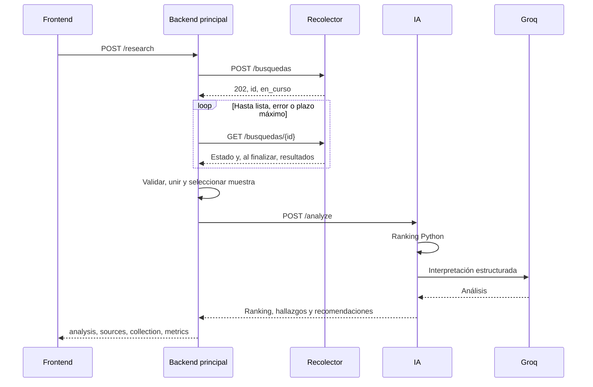

# Referencia de endpoints — 30X RADAR

Esta referencia describe el código del repositorio y el despliegue comprobado el
18 de octubre de 2026 (Colombia). El informe de ejecución es
[`endpoint_audit_2026-10-18.json`](endpoint_audit_2026-10-18.json). Los tiempos son
observaciones de esa ejecución, no garantías de latencia ni disponibilidad.

## Resultado de la auditoría

| Comprobación real | Resultado |
|---|---|
| Salud, documentación y OpenAPI de los tres servicios | HTTP 200 |
| ReDoc de principal e IA | HTTP 200 |
| Cuerpos vacíos en los tres POST | HTTP 422, rechazados antes de hacer trabajo externo |
| ID inexistente de búsqueda | HTTP 404 |
| Investigación YouTube, muestra de uno | HTTP 200 en 4,59 s; esquema, métricas, fuentes y referencias válidos |
| Investigación LinkedIn, ventana predeterminada | HTTP 422; nueve publicaciones fuera de fecha, cero utilizables, sin IA |
| LinkedIn, ventana ampliada explícita de 30 días | HTTP 200 en 11,37 s; métricas y referencias válidas; ranking vacío sin vistas |
| Análisis directo de un ejemplo ficticio | HTTP 200 en 2,71 s, esquema y referencias válidos |
| Consulta de la búsqueda existente de TikTok | HTTP 200; tres cuentas fallidas, captura detenida, cero publicaciones/métricas |

Las pruebas locales aprobaron 88 casos del principal y 62 de IA. El recorrido real
de TikTok con datos no está confirmado: requiere resolver la captura del recolector.
No se creó otra tarea de TikTok durante esta auditoría.

Se observó además una limitación generada por el modelo que calificaba métricas
como «bajas» sin referencia. Es un problema de calidad editorial pendiente, aunque
el contrato JSON sea válido. No interpretar HTTP 200 como verificación factual de
todas las frases del modelo. La integración del navegador y CORS requiere probar
el origen real del frontend, que aún no se ha proporcionado.

## Servicios y responsabilidades

| Servicio | URL base | Responsabilidad |
|---|---|---|
| Principal | `https://tred-radar.onrender.com` | Recibir frontend, recolectar, preparar, seleccionar y analizar |
| IA | `https://ia-analisis.onrender.com` | Validar publicaciones, calcular ranking Python y consultar Groq |
| Recolector | `https://radar-recoleccion.onrender.com` | Obtener publicaciones/métricas y administrar búsquedas temporales |



El frontend normalmente solo consume el servicio principal. No hay base de datos
ni historial persistente. El recolector guarda tareas en memoria, hasta 20; un
reinicio puede perderlas. La clave Groq vive exclusivamente en el servicio IA.

## Inventario

| Servicio | Método y ruta | Entrada | Salida |
|---|---|---|---|
| Principal | GET `/health` | Ninguna | Disponibilidad, modo y destino de IA |
| Principal | POST `/research` | Pregunta, audiencia y filtros | Investigación preparada para frontend |
| IA | GET `/health` | Ninguna | `{"status":"ok"}` |
| IA | POST `/analyze` | Pregunta, audiencia y publicaciones | Ranking y análisis |
| Recolector | GET `/salud` | Ninguna | `{"estado":"ok"}` |
| Recolector | POST `/busquedas` | Tema, redes, días y países | 202 con ID de tarea |
| Recolector | GET `/busquedas/{id}` | ID en la ruta | Estado y resultado temporal |

Los tres servicios publican GET `/docs` y `/openapi.json`. Principal e IA también
publican `/redoc`. `/` no es una ruta de negocio: un 404 allí no prueba una caída.
Los endpoints de salud no llaman a proveedores ni comprueban cuotas o credenciales.
Principal e IA usan errores `{"error": ...}`; el recolector puede usar `{"detail": ...}`.

## Principal: GET /health

No requiere cuerpo ni autorización. Ejemplo de HTTP 200:

```json
{
  "status": "ok",
  "service": "main_backend",
  "collector_mode": "http",
  "ai_target": {"host": "ia-analisis.onrender.com", "path": "/analyze"}
}
```

`ai_target` muestra configuración efectiva sin claves ni parámetros. El dominio
anterior `radar-ai-8xi7.onrender.com` ya no es el destino esperado.

## Principal: POST /research

Headers: `Content-Type: application/json`, opcional `Accept: application/json`.
Sin autenticación de usuario implementada en esta fase. Una solicitud válida sí
puede consumir cuotas del recolector y de Groq. Solo una plataforma por solicitud.

### Entrada

```json
{
  "question": "¿Qué enfoques aparecen y qué contenido útil sobre IA podría producir 30X? No afirmes crecimiento reciente.",
  "audience": "Líderes y equipos de Latinoamérica que aplican IA en su trabajo",
  "filters": {
    "query": "inteligencia artificial",
    "platform": "youtube",
    "country": "CO",
    "sample_size": 1
  }
}
```

| Campo | Obligatorio | Regla |
|---|---|---|
| `question` | Sí | Texto no vacío, hasta 1500 caracteres |
| `audience` | Sí | Texto no vacío, hasta 1000 |
| `filters` | Sí | Objeto, sin campos extra |
| `filters.query` | Sí | Texto 1–200; una frase o hasta cinco términos distintos por comas; hashtag requiere texto |
| `filters.platform` | No | `youtube`, `linkedin`, `tiktok`; predeterminado `youtube` |
| `filters.language` | No | Dos letras minúsculas, p. ej. `es`; `null` desactiva el filtro |
| `filters.country` | No | Dos letras mayúsculas; predeterminado operativo CO, configurable |
| `filters.published_after` | No | Fecha ISO 8601 con zona; pasado, hasta 36500 días atrás |
| `filters.published_before` | No | Fecha con zona; no anterior al inicio |
| `filters.sample_size` | No | Entero estricto 1–10; predeterminado 5 |

El cuerpo máximo es 256 KiB. No hay conversiones de booleanos o cadenas a
`sample_size`. Fechas sin zona y campos desconocidos se rechazan.

### Traducción al recolector y selección

- `query` → `tema`, `platform` → `redes: [platform]`, país → `paises: [country]`.
- Sin fecha inicial, `dias` usa `COLLECTOR_DEFAULT_DAYS` (predeterminado 7).
- Con fecha inicial, se calcula la ventana en días desde UTC actual, redondeando
  hacia arriba con un día de margen; después se aplica el corte exacto localmente.
- Fecha final e idioma se filtran localmente. Un idioma desconocido se excluye
  si se pidió ese filtro. No se exige coincidencia literal del tema en cada título.
- País significa región de búsqueda de YouTube, no ubicación del autor. El código
  del recolector no aplica ese filtro a LinkedIn/TikTok.
- Se unen IDs completos `yt:`, `li:`, `tt:`. Duplicados, tipos inválidos y registros
  sin métricas asociadas se excluyen y aparecen en el reporte.
- Se preserva la captura de cada métrica. `autor_hash` no se convierte en nombre.
- Con vistas conocidas, selección descendente por vistas, con desempate por ID.
- Sin ninguna vista conocida, selección por ID ascendente para analizar metadatos.
  No es un ranking de desempeño. Si hay vistas conocidas no se rellenan plazas
  con publicaciones sin vistas. `sample_size` es máximo, no cantidad garantizada.
- No limita cuántas publicaciones obtiene el recolector. Este puede devolver más;
  solo la muestra seleccionada se envía a IA.

### Salida HTTP 200

Ejemplo ficticio completo de estructura para LinkedIn sin vistas:

```json
{
  "analysis": {
    "summary": "El texto de ejemplo menciona automatización de reportes con IA.",
    "findings": [{
      "observation": "La descripción menciona reportes de equipo.",
      "hypothesis": null,
      "source_video_ids": ["li:1234567890123456789"]
    }],
    "recommendations": [{
      "title": "Cómo revisar un reporte generado con IA",
      "suggested_format": "Publicación educativa",
      "reason": "Propone una práctica concreta para equipos; su eficacia no está demostrada por la muestra.",
      "source_video_ids": ["li:1234567890123456789"]
    }],
    "limitations": ["Datos ficticios; sin vistas ni historial para comparar desempeño."],
    "ranking": [],
    "ranking_method": "views_desc",
    "unranked_video_ids": ["li:1234567890123456789"],
    "analysis_mode": "groq"
  },
  "sources": [{
    "id": "li:1234567890123456789",
    "platform": "linkedin",
    "title": null,
    "url": "https://www.linkedin.com/feed/update/urn:li:activity:1234567890123456789/"
  }],
  "metrics": [{
    "id": "li:1234567890123456789",
    "platform": "linkedin",
    "views": null,
    "likes": 12,
    "comments": 0,
    "shares": null,
    "metrics_collected_at": "2026-10-17T12:00:00Z"
  }],
  "collection": {
    "mode": "http",
    "simulated": false,
    "filters": {
      "query": "inteligencia artificial",
      "platform": "linkedin",
      "language": null,
      "country": null,
      "published_after": null,
      "published_before": null,
      "sample_size": 1
    },
    "preparation": {
      "search_id": "0123456789abcdef0123456789abcdef",
      "selected_ids": ["li:1234567890123456789"],
      "selected_count": 1,
      "selection_method": "id_asc_no_known_views"
    }
  }
}
```

`preparation` es un objeto de diagnóstico extensible: en ejecución incluye conteos,
IDs sin coincidencia, errores de normalización, parámetros enviados al recolector,
fechas de captura por ID y selección. No se debe depender de un orden de claves.

`metrics` contiene una fila por fuente seleccionada: vistas, likes, comentarios y
compartidos/republicaciones. Los cuatro son enteros no negativos o `null`. Likes
no significa automáticamente todas las reacciones; vistas no se rellenan con
impresiones. No se comparan directamente métricas entre plataformas.

El ranking lo calcula Python por vistas, no el modelo. Empates comparten posición
(`1,1,3`), con orden por ID; cero sí participa, `null` no. Los IDs de hallazgos y
recomendaciones deben existir en las fuentes. Las listas pueden estar vacías si
faltan evidencias. Validación estructural no garantiza conclusiones correctas.

## IA: POST /analyze

Endpoint para integración backend y diagnóstico, no necesario para el frontend.
No consulta el recolector ni descarga las URLs recibidas. Una inferencia por
solicitud, salvo el reintento limitado de fallos transitorios del cliente Groq.

```json
{
  "question": "PRUEBA FICTICIA: propone una idea para 30X sin afirmar crecimiento.",
  "audience": "Líderes y equipos de Latinoamérica",
  "videos": [{
    "platform": "linkedin",
    "id": "li:1234567890123456789",
    "title": null,
    "description": "Texto ficticio sobre automatización de reportes con IA.",
    "author": null,
    "url": "https://www.linkedin.com/feed/update/urn:li:activity:1234567890123456789/",
    "published_at": "2026-10-16T12:00:00Z",
    "metrics_collected_at": "2026-10-17T12:00:00Z",
    "views": null,
    "likes": 12,
    "comments": 0,
    "shares": null
  }]
}
```

Se conserva `videos` y `source_video_ids` por compatibilidad, incluso para texto.
Pregunta 1–2000, audiencia 1–1000, lista 1–30, IDs únicos de hasta 128 caracteres,
una plataforma por solicitud. `platform` puede inferirse por prefijo; YouTube
antiguo sin prefijo sigue admitido. Prefijo y dominio deben coincidir.

Título hasta 500, descripción hasta 5000, autor hasta 300. Título obligatorio para
YouTube; las otras redes requieren título o descripción no vacía. Fechas con zona
y captura igual o posterior a publicación. URL HTTPS de dominios admitidos de la
plataforma, incluido `lnkd.in`. `views`, `likes`, `comments` deben estar presentes,
aunque sean `null`; `shares` es opcional y vale `null` por defecto. Métricas estrictas:
sin cadenas, booleanos, negativos ni decimales.

Salida 200: el objeto `analysis` del ejemplo anterior, sin el envoltorio de
`/research`. No contiene `sources`, `metrics` ni `collection`.

## Recolector: inicio y consulta

### POST /busquedas

```json
{"tema":"inteligencia artificial","redes":["youtube"],"dias":7,"paises":["CO"]}
```

`tema` obligatorio, frase o 1–5 términos distintos por comas. `redes` opcional:
youtube/linkedin/tiktok; si se omite, el recolector busca en todas. `dias` entero
1–36500, predeterminado 7. `paises` lista no vacía de códigos de dos letras; el
predeterminado del recolector es MX, CO, AR, CL, PE. El backend principal envía
siempre una sola red y un país explícito para evitar ese alcance por defecto.

Salida 202:

```json
{"id":"0123456789abcdef0123456789abcdef","estado":"en_curso"}
```

No requiere token en este despliegue. Un 409 significa otra búsqueda activa; 422
indica entrada inválida. **No reintentar automáticamente este POST**: si se pierde
la respuesta podría haberse creado una tarea. El backend tampoco lo reintenta.

### GET /busquedas/{id}

En curso: `{"estado":"en_curso","resumen":{}}`. Finalizada:

```json
{
  "estado": "lista",
  "resumen": {"youtube":{"publicaciones":1,"metricas":1,"fallidas":0}},
  "publicaciones": [{
    "id":"yt:ejemplo", "plataforma":"youtube", "titulo":"Ejemplo ficticio",
    "texto":"Descripción ficticia", "autor_hash":"hash-sin-nombre",
    "url":"https://www.youtube.com/watch?v=ejemplo",
    "publicada_en":"2026-10-16T12:00:00Z"
  }],
  "metricas": [{
    "publicacion_id":"yt:ejemplo", "capturada_en":"2026-10-17T12:00:00Z",
    "vistas":100, "likes":null, "comentarios":0, "compartidos":null
  }]
}
```

Ejemplo resumido ficticio; los objetos reales incluyen otros metadatos. El
normalizador utiliza `metricas[].capturada_en`, no la captura de la publicación.
Fallida: `{"estado":"error","resumen":{},"mensaje":"No se pudo completar la búsqueda"}`.
HTTP 404 si el ID no existe o se perdió. `estado: lista` no garantiza publicaciones:
el resumen puede señalar captura detenida o consultas parcialmente fallidas.

## Errores del principal y de IA

```json
{"error":{"code":"invalid_input","message":"Revisa pregunta, audiencia y filtros.","details":[]}}
```

| HTTP | Códigos / significado |
|---|---|
| 413 | `body_too_large`: límite de entrada |
| 422 | `invalid_input`, `invalid_collector_filters`, `no_usable_videos` |
| 502 | `collector_capture_failed`, `collector_search_failed`, `collector_search_lost`, contratos/respuestas inválidas de dependencias |
| 503 | Recolector ocupado, límites, autenticación o indisponibilidad de dependencias |
| 504 | Plazo total o de una dependencia agotado |

Diagnóstico de recolección: `details` puede contener `service`, `platform`,
`search_id`, conteos, `ai_called: false` y `reason`. Vacío legítimo:
`empty_collection`; registros sin coincidencias válidas: `no_valid_matches`;
captura detenida/fallida: `capture_failed_or_stopped`. TikTok fallido no es una
investigación exitosa sin métricas.

Diagnóstico IA: `details` puede contener `upstream_status` y `upstream_code`.
Prefijos como `ai_provider_rate_limited`, `ai_invalid_provider_response` y
`ai_invalid_input` identifican el fallo. `ai_error` sin código reconocido puede
ser respuesta de un proxy o servicio; no demuestra fallo de credenciales Groq.
`collector_start_uncertain` requiere detener reintentos y conservar cualquier ID.

## Tiempos, límites y alcance de la auditoría

Valores predeterminados del código: petición al recolector 30 s, búsqueda total
150 s, pausa entre consultas 2 s, IA 45 s, investigación total 210 s. En Render
se han ajustado durante las pruebas: esas variables pueden diferir. Postman con
270 s no cambia los plazos del servidor. Un aborto del cliente no cancela la tarea.

Los servicios pueden tardar en arrancar. La salud no demuestra disponibilidad de
Groq. No hay streaming ni endpoint de progreso de `/research`. No hay persistencia,
autenticación de usuarios ni limitación de cuota por usuario en este MVP.

La auditoría no fuerza caídas, cuotas agotadas ni concurrencia en producción.
Esos escenarios se prueban localmente con clientes simulados. Los éxitos de
YouTube/LinkedIn y el estado de TikTok deben leerse en el informe adjunto, sin
convertir una prueba puntual en garantía de funcionamiento permanente.
